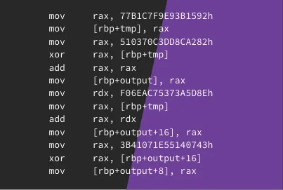

## Background
So Interrupt Labs publishes a set of practise challenges on their site, but alongside the usual challenges, they also post challenge business cards, which I think is pretty cool. They usually hand these cards out at conferences and they contain secret messages. One of these business cards stood out to me, as the only thing on it is x86 intel assembly.



But who has the time to manually work out the result of the assembly? Let's write a VM instead!

## Goal
Okay so, my goal for this is to create a minimal VM in C++ that will emulate the instructions on the business card, and output the result.

Looking at the business card, I actually only need to emulate three instructions; `mov`, `add` and `xor`. On top of this, I only need to support three kinds of operands: registers, immediate values, and things on the stack. Finally, I again only need to support three registers `rax`, `rdx` and `rbp`.

## Parsing the instructions
Almost every instruction in x86 intel assembly can be generalized in this form: `OPERATION DESTINATION, SOURCE`

Because of this, parsing the instruction to get the `OPERATION` part of it, all we have to do is read from the start of the instruction and read up until we get a space. However, this parsing is made even easier with string streams!

```c++
enum Instruction_type {
    MOV,
    ADD,
    XOR,
    NOP
};

inline std::map<std::string_view, Instruction_type> instruction_map = {
    {"mov", MOV}, {"add", ADD}, {"xor", XOR}, {"nop", NOP}
};

Instruction parse_instruction(std::string_view str) {
    std::stringstream ss(str.data());
    std::string op_str, dst_str, src_str;

    if (!(ss >> op_str >> dst_str >> src_str)) throw std::runtime_error("Invalid instruction");

    Operand dst = parse_operand(dst_str);
    Operand src = parse_operand(src_str);

    if (!instruction_map.contains(op_str)) {
        throw std::runtime_error("Invalid or unsupported instruction");
    }

    return Instruction(instruction_map.at(op_str), dst, src);
}
```

From the above code, we can parse the instruction for what operation it performs.

## Parsing operands

Parsing operands is a little trickier, as the type of operand is given by the format of it, whereas the instructions were guaranteed to all be in the same format.

Firstly, what we need to do is strip out any leading whitespace or trailing commas from the operand. Then, we need to determine what kind of operand it is.

For operands that reference memory or stack values, we can simply check the first and last character of the operand, as they will always start with `[` and end with `]`. After stripping the square brackets from the operand, we would be left with an expression that follows this format: `REGISTER+DISPLACEMENT`. So, what we can do is read the register and check to make sure it's either `rax`, `rdx` or `rbp`, then we can convert the `DISPLACEMENT` part of the string, into an integer.

If the operand does not start with `[` and end with `]`, then we can assume that the operand is either a register or an immediate value. To check if the operand is a register, we can simply check if the operand is `rax`, `rdx` or `rbp`. If it's not, then it's probably an immediate value.

```c++
enum Register {
    RAX,
    RDX,
    RBP,
    UNKNOWN
};

inline std::map<std::string_view, Register> reg_map = {
    {"rax", RAX}, {"rdx", RDX}, {"rbp", RBP}
};

struct Operand {
    Register reg = UNKNOWN;
    bool is_mem = false;
    bool is_imm = false;
    std::uint64_t imm = 0;
    std::int64_t displacement = 0;
};

Operand parse_operand(std::string_view str) {
    Operand op;

    while (!str.empty() && (str.back() == ',' || std::isspace(static_cast<unsigned char>(str.back())))) { str.remove_suffix(1); }
    while (!str.empty() && std::isspace(str.front())) {str.remove_prefix(1); }

    if (str.empty())
        return op;

    if (str.front() == '[' && str.back() == ']') {
        op.is_mem = true;
        str = str.substr(1, str.size() - 2);

        if (!str.contains('+') && !str.contains('-')) {
            if (reg_map.contains(str)) {
                op.reg = reg_map.at(str);
            }
            else {
                op.is_imm = true;
                op.imm = std::strtoull(str.data(), nullptr, 16);
            }
        }
        else {
            op.is_imm = false;
            std::string_view reg = str.substr(0, 3);

            if (!reg_map.contains(reg))
                throw std::runtime_error("Invalid register");

            op.reg = reg_map.at(reg);

            std::string_view displacement_str = str.substr(3);
            int base = 10;

            if (displacement_str.front() == '+') {
                if (displacement_str.back() == 'h') {
                    base = 16;
                    displacement_str.remove_suffix(1);
                }

                op.displacement = std::strtoll(displacement_str.substr(1).data(), nullptr, base);
            }
            else if (displacement_str.front() == '-') {
                if (displacement_str.back() == 'h') {
                    base = 16;
                    displacement_str.remove_suffix(1);
                }

                op.displacement = -std::strtoll(displacement_str.substr(1).data(), nullptr, base);
            }
        }
    }

    else if (reg_map.contains(str))
        op.reg = reg_map.at(str);
    else {
        op.is_imm = true;
        op.imm = std::strtoull(str.data(), nullptr, 16);
    }

    return op;
}
```

## The actual VM
Okay, so at this point we have a way to parse assembly, and turn it into instructions that we can then act on. Now its time for the fun part, writing the VM!

Instructions are provided to the VM as an array, so the VM can simply iterate over each instruction, check the operation, and then act accordingly based on the operands. When the VM is initialised, it allocates `0x1000` bytes of memory for `rbp`, to function as the stack.

```c++
std::uint64_t VM::decode_operand_value(const Operand& operand) {
    std::uint64_t value = 0;

    if (operand.is_imm) {
        value = operand.imm;
    }
    else if (operand.is_mem) {
        value = *reinterpret_cast<std::uint64_t*>(get_reg_value(operand.reg) + operand.displacement);
    }
    else {
        value = get_reg_value(operand.reg);
    }

    return value;
}

void VM::run() {
    for (auto curr_instruction : instructions) {
        auto src = curr_instruction.get_src();
        auto dst = curr_instruction.get_dst();

        switch (curr_instruction.get_operation()) {
            case Instruction_type::NOP:
                break;
            case MOV: {
                std::uint64_t value = decode_operand_value(src);

                if (dst.is_mem) {
                    *reinterpret_cast<std::uint64_t*>(get_reg_value(dst.reg) + dst.displacement) = value;
                }
                else if (dst.reg != UNKNOWN) {
                    set_reg_value(dst.reg, value);
                }
                else {
                    throw std::runtime_error("destination operand is invalid for MOV");
                }

                break;
            }
            case ADD: {
                std::uint64_t value = decode_operand_value(src);

                if (dst.is_mem) {
                    *reinterpret_cast<std::uint64_t*>(get_reg_value(dst.reg) + dst.displacement) += value;
                }
                else if (dst.reg != UNKNOWN) {
                    set_reg_value(dst.reg, get_reg_value(dst.reg) + value);
                }
                else {
                    throw std::runtime_error("destination operand is invalid for ADD");
                }
                break;
            }
            case XOR: {
                std::uint64_t value = decode_operand_value(src);

                if (dst.is_mem) {
                    *reinterpret_cast<std::uint64_t*>(get_reg_value(dst.reg) + dst.displacement) ^= value;
                }
                else if (dst.reg != UNKNOWN) {
                    set_reg_value(dst.reg, get_reg_value(dst.reg) ^ value);
                }
                else {
                    throw std::runtime_error("destination operand is invalid for ADD");
                }
                break;
            }
        }
    }
}
```

## The solution
So now we have a parser and a VM that will effectively execute the assembly! Now all that's needed is some code to setup the VM, run the VM and then output the solution.

```cpp
int main()
{
    std::vector<card_vm::Instruction> instructions = {
        card_vm::parse_instruction("mov rax, 77B1C7F9E93B1592h"),
        card_vm::parse_instruction("mov [rbp+100], rax"),

        card_vm::parse_instruction("mov rax, 510370C3DD8CA282h"),
        card_vm::parse_instruction("xor rax, [rbp+100]"),
        card_vm::parse_instruction("add rax, rax"),
        card_vm::parse_instruction("mov [rbp+200], rax"),

        card_vm::parse_instruction("mov rdx, F06EAC75373A5D8Eh"),
        card_vm::parse_instruction("mov rax, [rbp+100]"),
        card_vm::parse_instruction("add rax, rdx"),
        card_vm::parse_instruction("mov [rbp+216], rax"),

        card_vm::parse_instruction("mov rax, 3B41071E55140743h"),
        card_vm::parse_instruction("xor rax, [rbp+216]"),
        card_vm::parse_instruction("mov [rbp+208], rax"),
    };

    card_vm::VM vm = card_vm::VM(instructions);
    vm.run();

    auto rbp = vm.get_reg_value(card_vm::RBP);

    for (auto block = 0; block < 24; block += 8) {
        for (auto i = 7; i >= 0; i--) {
            auto byte = *reinterpret_cast<std::uint8_t*>(rbp + 200 + i + block);

            std::printf("%X", byte);
        }
    }

    std::printf("\n");

    return 0;
}
```

And to make sure that this was the correct output, I then manually evaluated the assembly, which it was. No, the irony is not lost on me.

## Key takeaways

Writing a tiny VM instead of manually evaluating the assembly took more time and effort, but it was fun. It was a good little project to better understand how emulators and VMs work.

Parsing was fiddlier than I expected going into it. The instructions themselves are trivially structured, but operands are not. If the card had a wider instruction set, I would want to create a proper tokenizer, rather than relying on string slicing, as that can break fast when scaled up.